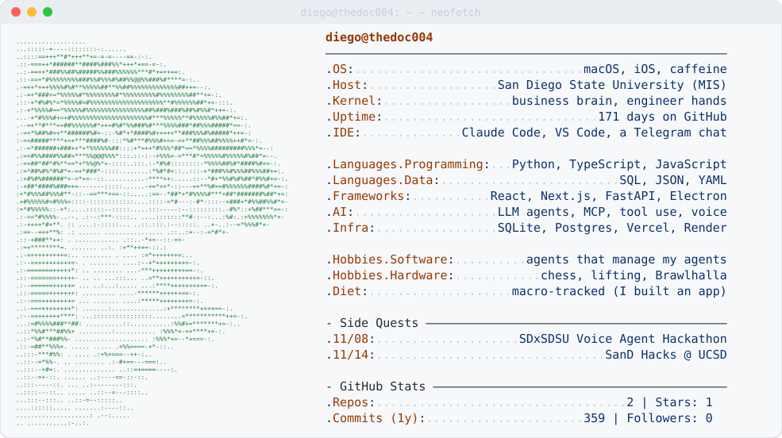

<a href="https://github.com/TheDoc004">
  <picture>
    <source media="(prefers-color-scheme: dark)" srcset="assets/neofetch-dark.svg">
    
  </picture>
</a>

### hey, i'm diego 🐤

MIS student at **San Diego State**. I build AI agents to do my chores, then I build more agents to manage those agents. It's agents all the way down.

I'm half business, half engineering: I care about *why* a thing should exist, and then I stay up too late making it actually exist.

> **this month's side quests:** 🎙️ building a voice agent at the **SDxSDSU Voice Agent Hackathon** (Sun 11/8, ZIP Launchpad) · 🌊 **SanD Hacks** @ UCSD (11/14–15). If you see me, I'm probably the one explaining my agent's org chart.

---

### 🛠️ things i built instead of sleeping

| project | what it does | built with |
|---|---|---|
| 🌾 **Noggin Valley** | A farm-sim style desktop app where AI agents keep my projects moving while I'm away. Every project is a district with its own agents. One "Mayor" agent in Telegram triages everything and sends me only the decisions that are actually mine. Each district has a goal keeper that measures progress from real data, not vibes. | Python · Electron · multi-agent orchestration · LLM tool use · Telegram Bot API |
| 🥗 **[FLOPS](https://github.com/TheDoc004/flops)** · [live ↗](https://www.useflops.com) | The nutrition and training notebook I use every day. It photo-scans nutrition labels (OCR), looks up barcodes, logs gym sets, tracks estimated 1RM, has a read-only coach view, and has an **MCP server** so Claude can log my meals for me. | React · Vite · Node.js · Express · SQLite · MCP · Tesseract.js · Vercel · Render |
| 📈 **Diegonomics** | My personal money system: an automated prediction-market (Kalshi) trading bot with paper trading, strategy plugins, and a research pipeline where agents have to *prove* a strategy before it gets near real money. | Python · data pipelines · backtesting · risk controls |
| 🔦 **Lumidian** | A team-built SaaS dashboard that tracks how often brands show up in ChatGPT, Claude, Perplexity and Gemini answers (GEO / AI search visibility), with scheduled runs, trend charts, and AI-drafted content to close the gaps. | Next.js 15 · TypeScript · Tailwind · FastAPI · SQLAlchemy · LLM APIs |

<sub>🔒 some of these live in private repos while I scrub out my personal data. Happy to demo any of them.</sub>

---

### 🧰 the toolbox

<p>
  
</p>

- **AI / agents:** LLM agents, multi-agent systems, tool calling, Model Context Protocol (MCP), prompt engineering, voice AI, Claude / OpenAI / Gemini / Perplexity APIs
- **Languages:** Python, TypeScript, JavaScript, SQL, HTML/CSS
- **Frameworks:** React, Next.js, FastAPI, Node.js / Express, Electron, Tailwind CSS, SQLAlchemy
- **Data & infra:** SQLite, PostgreSQL, REST APIs, Vercel, Render, GitHub Actions, Git
- **The MIS part:** product thinking, systems analysis, data-driven decisions, shipping MVPs fast and then using them myself

---

### 🧾 patch notes · `diego v20.26`

```diff
+ added: voice agents (hackathon pending, results may vary)
+ added: a nutrition app, because counting macros by hand is for people with free time
+ improved: agents now ask before doing anything with real money (ask me how I learned)
- removed: doing things manually
! known issue: will turn any problem into a multi-agent system
! known issue: "quick side project" estimates are off by about 10x
```

### 🐤 fun facts
- This card regenerates itself every night with a GitHub Action. I automated my own README.
- I play chess, lift, and lose at Brawlhalla.
- The ASCII guy up top is me, rendered from a car selfie by a Python script. The hair took the most characters.
- Before the portrait, a rubber duck sat there. It's still in the script as a fallback. It has solved more bugs than any of my LLMs. Don't tell them.

---

### 📫 come say hi

[LinkedIn](https://www.linkedin.com/in/diegoramirez004) · [email](mailto:diegoram1227mater@gmail.com) · or find me at the next San Diego hackathon, I'll be the one with the protein froyo.
